

  

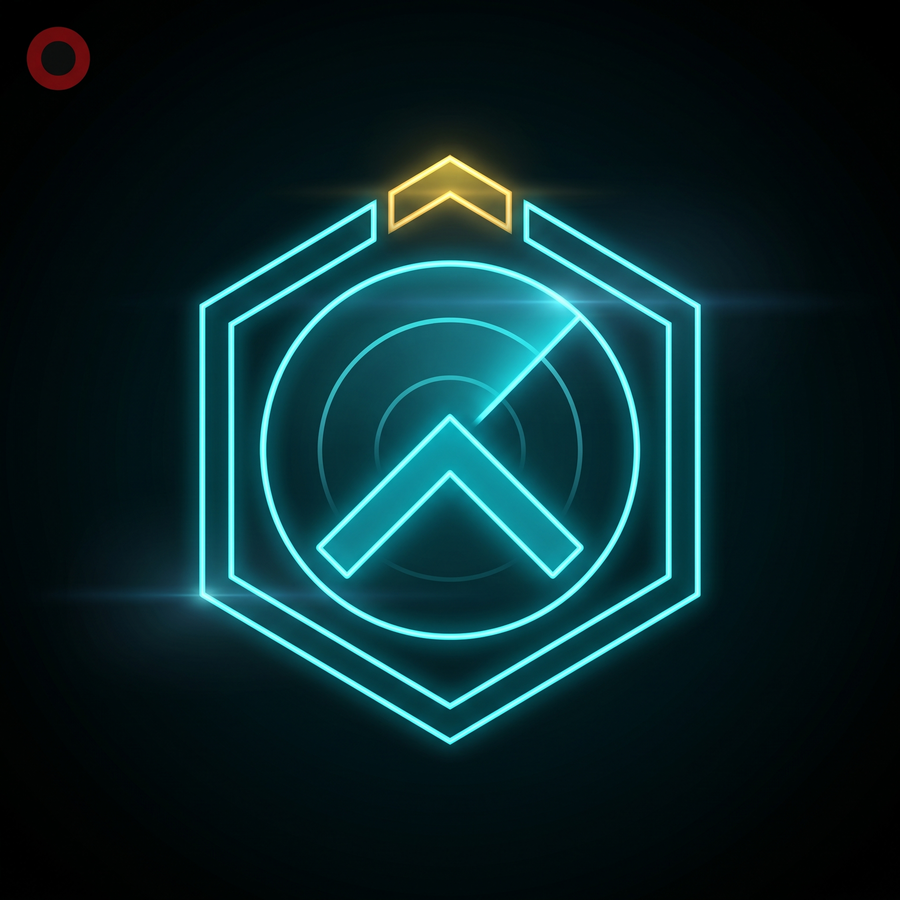

  <strong>Cybersecurity Researcher & Developer</strong> 
  <em>Offensive Security · OS Internals · AI Tooling</em> 
  <em>Penetration Testing · Bug Bounty · Zero-Day Research</em>

  <strong>At a Glance</strong>

- **Role:** Gavin Blacklock, security engineer and researcher. Epsilon0xCell is the name on the account; the work is where offensive security, operating-system internals, and AI tooling meet.
- **Fleet:** 763 repositories across my account and my organizations. At the center, a 584-project library, built under my direction and audited line by line.
- **Succession proof:** [proof-of-succession](https://github.com/Epsilon0xCell/proof-of-succession) indexes 2,867 commits under my name, across 32 repositories.
- **Credentials:** GIAC Security Essentials (GSEC) and GIAC Foundational Cybersecurity Technologies (GFACT), and invited member of the GIAC Advisory Board.
- **Recognition:** Seventy-second nationally in the NSA Codebreaker Challenge, alone. National Cyber Scholar with Honors, three years running.
- **Standing:** The Scholar title is earned by 600 of 30,000 students who seek to qualify: the top 2% of the national cybersecurity student funnel, held with Honors three years running. He attained the CyberStart America maximum score of 147,600 in three consecutive program years. Measured against the whole field, an assessment of this record models the 88th percentile of all participants in cybersecurity, and a modeled 76th percentile among working professionals alone.
- **Flagships:** Four flagships, each with a single charge. ShadowStrike OS, the platform. NightSalvo, the flagship tool. Event_Zero, AI analysis in isolation. Eclipse Shield, a hardened Flask backend.
- **CVE Record:** Fourteen published advisories from my own fleet audit and fifty-three third-party coordinated disclosures, every one linked to its live record. Full record: see CVE Record below.
- **CTF Writeups:** [NIGHTSALVO // CTF WRITEUPS](https://github.com/Epsilon0xCell/NIGHTSALVO-CTF-WRITEUPS): 11 solved challenges written up in full, ranked on a tier ladder that starts at INITIATE.

**The Neon Command Deck**
_One chair, one curved display, and a fleet of seven hundred lights at anchor beyond the glass. This is the front door to all of it._

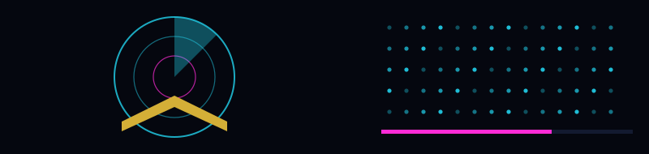

## CVE Record

Two CVE IDs have been assigned and published by the VulnCheck CNA: CVE-2026-120459 for python-jose, which credits me as a finder alongside Conner Webber, and CVE-2026-120492 for Chainlit. A third ID, CVE-2026-114360, is assigned to a webpack-dev-server advisory still in draft, where I am credited as a reporter. The remaining entries are filed records in review, and the closed ones say so plainly. Every entry links to its live advisory or submission record, and each entry gains its direct CVE record link the day an ID is assigned.

My method, in one line: I read a published security fix closely, then test whether the same flaw survives in a sibling surface the fix did not reach, and I file only when the surviving flaw reproduces against the current release with controls.

For disclosure coordination or follow-up on any record below, reach me through this GitHub account or at epsilon0cell@proton.me.

### Published advisories, CVE requested

Fourteen advisories from my own fleet audit, each found, fixed, and disclosed under my name:

- [GHSA-3f3v-f9h4-cr86](https://github.com/ShadowGuard-AI/pa-permission-human-review-reminder/security/advisories/GHSA-3f3v-f9h4-cr86): pa-permission-human-review-reminder: code injection through an eval() call run on a value taken from its JSON config file (CWE-95).
- [GHSA-25g4-c832-64qm](https://github.com/ShadowGuard-AI/tm-misconfigurationdetector/security/advisories/GHSA-25g4-c832-64qm): tm-misconfigurationdetector: code injection through eval() on rules-file conditions (CWE-95).
- [GHSA-jpj2-7hpf-cj7w](https://github.com/ShadowGuard-AI/dm-structured-data-anonymizer/security/advisories/GHSA-jpj2-7hpf-cj7w): dm-structured-data-anonymizer: code injection through eval() of config transformation rules (CWE-95).
- [GHSA-27ph-qx26-578x](https://github.com/ShadowGuard-AI/dm-data-conditional-masker/security/advisories/GHSA-27ph-qx26-578x): dm-data-conditional-masker: code injection through eval() of masking conditions (CWE-95).
- [GHSA-wgp3-ch2c-77vr](https://github.com/ShadowGuard-AI/sao-logeventcorrelator/security/advisories/GHSA-wgp3-ch2c-77vr): sao-logeventcorrelator: command injection through an os.system command built from a config pattern name (CWE-78).

View all coordinated disclosures: 50 more entries (55 in total, first 5 shown above)

- [GHSA-w4qr-hm9q-4wpr](https://github.com/ShadowGuard-AI/cvsa-dependency-checker/security/advisories/GHSA-w4qr-hm9q-4wpr): cvsa-dependency-checker: command injection through a shell=True command built from the project path (CWE-78).
- [GHSA-7crg-qw6v-xgmh](https://github.com/ShadowGuard-AI/cba-immutable-infrastructure-verifier/security/advisories/GHSA-7crg-qw6v-xgmh): cba-immutable-infrastructure-verifier: command injection through a definition-file service name (CWE-78).
- [GHSA-5589-fcgv-3r86](https://github.com/ShadowGuard-AI/spc-policyenforcergenerator/security/advisories/GHSA-5589-fcgv-3r86): spc-policyenforcergenerator: policy values escape into the Python and bash enforcement scripts the tool generates (CWE-94).
- [GHSA-64cm-g5wr-5r9v](https://github.com/ShadowGuard-AI/net-ssdp-discover/security/advisories/GHSA-64cm-g5wr-5r9v): net-ssdp-discover: server-side request forgery through the SSDP LOCATION header (CWE-918).
- [GHSA-537q-47qg-99wc](https://github.com/ShadowGuard-AI/tif-feedindicatorconverter/security/advisories/GHSA-537q-47qg-99wc): tif-feedindicatorconverter: path traversal in tarfile extraction (CWE-22).
- [GHSA-27jf-w9q3-9mc2](https://github.com/ShadowGuard-AI/pa-permission-consistency-checker/security/advisories/GHSA-27jf-w9q3-9mc2): pa-permission-consistency-checker: symlink-following chmod applied outside the checked tree (CWE-59).
- [GHSA-wrfq-r9wm-6rqw](https://github.com/ShadowGuard-AI/codeintel-fuzz-test-generator/security/advisories/GHSA-wrfq-r9wm-6rqw): codeintel-fuzz-test-generator: the generator executes the target module it presents as static analysis (CWE-829).
- [GHSA-3cff-rm2w-h9rp](https://github.com/ShadowGuard-AI/tma-threat-model-dataflowdiagramgenerator/security/advisories/GHSA-3cff-rm2w-h9rp): tma-threat-model-dataflowdiagramgenerator: PlantUML directive injection (CWE-74).
- [GHSA-h662-mq2p-c25h](https://github.com/Epsilon0xCell/Zenyx-Markdown-Reader/security/advisories/GHSA-h662-mq2p-c25h): Zenyx-Markdown-Reader: javascript: and data: URL passthrough (CWE-79).

### Third-party coordinated disclosures

Findings in other people's projects, reported under my name through coordinated disclosure:

- [Universal_HamRadio_Remote_HTML5](https://github.com/F4HTB/Universal_HamRadio_Remote_HTML5) (F4HTB): unauthenticated remote code execution through a configuration value, my CVSS estimate 9.8 in the default configuration. Reported under my name to [VulnCheck](https://www.vulncheck.com/advisories) for coordinated disclosure; in review. Submission ID: 7b38ff57-7ae7-4cfe-802b-1a0151b9b76f.
- [Authlib](https://github.com/authlib/authlib/security/advisories/GHSA-qh79-cpm4-66xr): public keys accepted as HMAC secrets, CVSS 7.4. Reported privately; in triage.
- [joserfc](https://github.com/authlib/joserfc/security/advisories/GHSA-r829-87wg-5fvm): public keys accepted as HMAC secrets, CVSS 7.4. Reported privately; in triage.
- [MLflow](https://github.com/mlflow/mlflow/security/advisories/GHSA-hq9f-8r34-rwfr): assessment_id path traversal, CVSS 7.0. Reported privately; in triage.
- [CVE-2026-120459](https://www.cve.org/CVERecord?id=CVE-2026-120459): python-jose, empty HMAC keys accepted, CVSS 7.4. Reported to VulnCheck for coordinated disclosure and published by the VulnCheck CNA on 2026-11-02, crediting me as a finder alongside Conner Webber. Global advisory GHSA-7jv8-hwmh-86qc. Submission ID: 4fa6aca3-107c-4303-8431-94435d352047.
- [fast-jwt](https://github.com/nearform/fast-jwt/security/advisories/GHSA-54w5-pr3p-mxx6): public keys accepted as HMAC secrets, CVSS 7.4. Reported privately; closed by the maintainers on 2026-11-02, who confirmed the behavior and documented it as a conscious design decision, so no advisory was published.
- [happy-dom](https://github.com/capricorn86/happy-dom/security/advisories/GHSA-wc23-gwfm-xp98): server-side request forgery through a preload fetch, CVSS 7.5. Reported privately; in triage.
- [LMDeploy](https://github.com/InternLM/lmdeploy/security/advisories/GHSA-6cpj-h37w-jc87): unauthenticated pickle deserialization, CVSS 9.8. Reported privately; in triage.
- [Langroid](https://github.com/langroid/langroid/security/advisories/GHSA-vqhw-xhff-464q): SQLite file read and write through a validator gap, CVSS 9.1. Reported privately; in triage.
- [Hydra](https://github.com/hydra-ecosystem/hydra/security/advisories/GHSA-6pjq-6rqq-35wh): pickle entry points left open by a target policy, CVSS 7.8. Reported privately; in triage.
- [Home Assistant](https://github.com/home-assistant/core/security/advisories/GHSA-v2j4-8cr2-8cmc): symlink following backup restore, CVSS 7.5. Reported privately; in triage.
- [LiteLLM](https://github.com/BerriAI/litellm/security/advisories/GHSA-x38x-j3hm-5gq5): Responses API id forgery, CVSS 7.1 per the filed vector (the packet stated 6.4). Reported privately; in triage.
- [OAuthLib](https://github.com/oauthlib/oauthlib/security/advisories/GHSA-7pg3-fhv6-chf6): split client identity on revocation and introspection, CVSS 6.3. Reported privately; in triage.
- [CVE-2026-120492](https://www.cve.org/CVERecord?id=CVE-2026-120492): Chainlit, MCP allowlist scope escape through a semicolon path segment, CVSS 6.5 per my filed vector (published at 5.4). Reported to VulnCheck for coordinated disclosure and published by the VulnCheck CNA on 2026-11-02 as an incomplete fix of CVE-2026-45019. Global advisory GHSA-xhx7-9vjr-p2h8. Submission ID: be91a8cb-6b80-4c6b-a1b3-6f8c97a6076f.
- [fsspec](https://github.com/fsspec/filesystem_spec/security/advisories/GHSA-cwp7-cgc4-m57x): template evaluation through the simple-template branch an earlier fix missed, CVSS 7.4. Reported privately; in triage.
- [gradio](https://github.com/gradio-app/gradio/security/advisories/GHSA-m2fv-grp4-vp4v): multipart field data with no size limit, CVSS 7.5. Reported privately; in triage.
- [gunicorn](https://github.com/benoitc/gunicorn/security/advisories/GHSA-gx3p-p99v-cv34): ASGI chunk terminator never verified, CVSS 6.5 per the filed vector (the packet stated 5.4, corrected at filing). Reported privately; in triage.
- [setuptools](https://github.com/pypa/setuptools/security/advisories/GHSA-5vqf-4rwp-q5w8): MANIFEST.in exclusion bypass in the vendored distutils file list, CVSS 2.5. Reported privately; in triage.
- [Django](https://github.com/django/django): a crafted SQL connector settable after Q construction, past the CVE-2025-64459 validation, CVSS 5.9. Reported to the Django security team by email; rejected by the Django Security Team on 2026-11-02 because Node.add and attribute assignment are outside Django's public API and out of scope per the CVE-2025-64459 remediation.
- [Django](https://github.com/django/django): in 5.2.18 and 6.0.9 the cache middleware tests the whole Cache-Control value for the text "public", so a value carrying that text inside another token or a quoted parameter skips the Vary: Authorization patch and an authorized response is served to anonymous requests, the residual shape of the CVE-2026-35193 fix, CVSS 5.3 suggested. Reported to the Django security team by email on 2026-11-02; awaiting response.
- [Apache Superset](https://github.com/apache/superset): chart update ties a chart to a dashboard the user can only read, CVSS 4.3. Reported to the Apache Superset security team by email, with the proof level stated in the report; in review.
- [marked](https://github.com/markedjs/marked/security/advisories/GHSA-24hm-c94w-w7mv): denial of service through asterisk emphasis delimiter runs, CVSS 7.5. Reported privately; closed by the maintainer on 2026-11-02, who judged it not a vulnerability in marked itself because marked documents worker usage for untrusted markdown. The first filing from the campaign's greenfield zero-day board.
- [multer](https://github.com/expressjs/multer/security/advisories/GHSA-9q5m-vwxv-555g): denial of service through an oversized array index in field names, with the shipped fix limit left at its disabled default, CVSS 7.5. Reported privately; closed by the maintainers on 2026-11-02 as out of scope, the observation confirmed and the opt-in limit documented as a deliberate backward compatibility decision.
- [form-data](https://github.com/form-data/form-data/security/advisories/GHSA-q552-jg2p-mhxj): CRLF header injection through the contentType option, surviving in the release that fixed the sibling name and filename channels, CVSS 5.3. Reported privately; in triage.
- [redis-py](https://github.com/redis/redis-py): pure Python RESP parsers accept negative lengths and fabricate empty responses, CVSS 6.5 per the filed vector (the packet stated 5.3, corrected at filing). Reported to [VulnCheck](https://www.vulncheck.com/advisories) for coordinated disclosure; in review. Submission ID: 1c52fb29-93bd-4ea2-a5af-332bc26e9333.
- [validator](https://github.com/validatorjs/validator.js/security/advisories/GHSA-6hq5-8g5q-9j52): isURL backslash host confusion bypasses a host whitelist, CVSS 6.5. Reported privately; in triage.
- [protobufjs](https://github.com/protobufjs/protobuf.js/security/advisories/GHSA-2qvh-fghc-g2q2): quadratic denial of service through fieldsById rebuilds during type construction, CVSS 5.3. Reported privately; in triage.
- [PyJWT](https://github.com/jpadilla/pyjwt/security/advisories/GHSA-9g97-wv24-r8wg): a malformed oct JWK missing its key material aborts parsing of the whole key set, CVSS 5.9. Reported privately; in triage.
- [Pillow](https://github.com/python-pillow/Pillow/security/advisories/GHSA-7qjr-cff2-jxr2): MSP RLE decoder clamp overshoots the packed row size eightfold, CVSS 5.3. Reported privately; in triage. The maintainer noted the referenced proof files were not attached, and I posted the full proof script and captured output into the advisory on 2026-11-02.
- [parse5](https://github.com/inikulin/parse5/security/advisories/GHSA-4h9c-4xh7-4fhc): quadratic denial of service through deeply nested special elements, CVSS 7.5. Reported privately; in triage.
- [vite](https://github.com/vitejs/vite/security/advisories/GHSA-ff9m-2v2v-33xp): a custom server.fs.deny entry silently discards the built-in sensitive-file blocklist, so .env files, private keys, .npmrc, and .git contents are served, CVSS 5.9. Reported privately; in triage.
- [webpack-dev-server](https://github.com/webpack/webpack-dev-server/security/advisories/GHSA-qr8q-8r62-4mm8): the same-origin fallback behind the internal endpoint CSRF guard accepts any Origin when the Host is allow-listed, an incomplete patch inside the GHSA-f5vj-f2hx-8m93 fix, CVSS 4.2 per the filed vector (the packet stated 4.4, corrected at filing). Reported privately; closed on 2026-11-02 as a duplicate and merged into the canonical advisory GHSA-pmx6-3hc4-22qg, where I am credited as a reporter. That advisory carries CVE-2026-114360 and is still in draft.
- [flask-cors](https://github.com/corydolphin/flask-cors/security/advisories/GHSA-rm89-pf93-g8gc): regex origins are matched without an end anchor, so a suffix domain is allowed with credentials, CVSS 7.4. Reported privately; in triage.
- [flask-cors](https://github.com/corydolphin/flask-cors/security/advisories/GHSA-p888-gf7m-j676): regex resource paths are matched without an end anchor, so sibling routes inherit the wrong CORS policy, CVSS 6.1. Reported privately; in triage.
- [nbconvert](https://github.com/jupyter/nbconvert/security/advisories/GHSA-j8j6-59gm-rvxq): the image embedding confinement check uses abspath, not realpath, so a symlink inside the notebook directory reads files outside it, CVSS 5.5. Reported privately; in triage.
- [Poetry](https://github.com/python-poetry/poetry/security/advisories/GHSA-94mw-r8vg-hp9c): wheel installation writes through a symlink component inside the target directory, a regression of the 2.3.3 fix, CVSS 4.7. Reported privately; in triage.
- [FastMCP](https://github.com/PrefectHQ/fastmcp/security/advisories/GHSA-j9pc-m9cw-hm35): the synthesized Prefab renderer resource for an authorization hidden tool is listed and readable and discloses the tool CSP configuration, CVSS 4.3. Reported privately; in triage. Filed against 4.1.6 after fresh re-verification, the prepared 4.1.5 text corrected and disclosed in the report.
- [pytest](https://github.com/pytest-dev/pytest/security/advisories/GHSA-gc9p-fxcv-8rvw): the cache provider writes through a planted symlink inside .pytest_cache, escaping the cache directory, CVSS 3.9. Reported privately; in triage.
- [content-disposition](https://github.com/jshttp/content-disposition/security/advisories/GHSA-7vg8-6w5c-f7vp): RFC 2231 continuation segments are never reassembled, so this parser and compliant consumers read different filenames, CVSS 3.7. Reported privately; in triage.
- [nanoid](https://github.com/ai/nanoid/security/advisories/GHSA-cc9f-9m87-3893): customRandom loops indefinitely for fractional and infinite sizes, CVSS 5.9. Reported privately; in triage.
- [mysql2](https://github.com/sidorares/node-mysql2/security/advisories/GHSA-mccj-fxgw-vqw2): object-form string 'false' silently enables the cleartext password plugin, CVSS 5.9. Reported privately; in triage.
- [diffusers](https://github.com/huggingface/diffusers/security/advisories/GHSA-m69w-mj5q-7pch): community pipeline branch has no trust_remote_code gate, so a community pipeline loads with trust_remote_code False, CVSS 7.5. Reported privately; in triage.
- [fpdf2](https://github.com/py-pdf/fpdf2/security/advisories/GHSA-v89r-w56q-vxcf): SVG pattern tiles are rebuilt per distinct bounding box outside SVGLimits, giving quadratic CPU exhaustion, CVSS 6.5. Reported privately; in triage.
- [llama-index-core](https://github.com/run-llama/llama_index/security/advisories/GHSA-hx22-9jfg-28f2): JSONNodeParser has no RecursionError containment for deeply nested JSON, CVSS 5.3. Reported privately; in triage.
- [websocket-client](https://github.com/websocket-client/websocket-client/security/advisories/GHSA-7vr3-hq82-mx3f): credentials follow cross-authority redirects, and a wss to ws downgrade is followed, CVSS 5.3. Reported privately; in triage.
- [litestar](https://github.com/litestar-org/litestar/security/advisories/GHSA-3rhv-523m-9gwr): AllowedHosts www redirect pattern is built without re.escape, so lookalike hosts receive redirects, CVSS 4.3. Reported privately; in triage.
- [websocket-client](https://github.com/websocket-client/websocket-client/security/advisories/GHSA-wrv8-wcqp-xhww): leading dot no_proxy entries match suffix lookalike hosts, sending traffic around the intended proxy, CVSS 3.7. Reported privately; in triage.
- [streamlit](https://github.com/streamlit/streamlit/security/advisories/GHSA-8qc9-p6h2-888w): cache_data hashing of PIL images omits mode and size, so distinct images with equal flat bytes collide, CVSS 3.6. Reported privately; in triage.
- [picomatch](https://github.com/micromatch/picomatch/security/advisories/GHSA-8hcr-8c58-v9pw): extglob ReDoS guard analyzes only plus and star spellings, so at and brace spellings stay unguarded, CVSS 5.3. Reported privately; in triage.
- [graphql](https://github.com/graphql/graphql-js/security/advisories/GHSA-qmvg-hxgh-p69p): fragment chain validation recurses one stack frame per link and throws RangeError on a 4,000 chain, CVSS 5.3. Reported privately; in triage.
- [unzipper](https://github.com/ZJONSSON/node-unzipper/security/advisories/GHSA-h59r-mc52-7pf5): Open API feeds the unchecked zip64 entry count into an array mapping, so a small archive exhausts the heap, CVSS 5.3. Reported privately; in triage.
- [unzipper](https://github.com/ZJONSSON/node-unzipper/security/advisories/GHSA-rc9h-q8pq-xcpx): Extract has no error route for ensureDir failures, so collisions and long names escape as unhandled rejections, CVSS 5.3. Reported privately; in triage.
- [sax](https://github.com/isaacs/sax-js/security/advisories/GHSA-xc8w-cpgp-8hpq): strict mode accepts duplicate attributes, two roots, and ]]> in content, CVSS 3.7. Reported privately; in triage.

> **Successor account.** This is the new home of the builder behind [@CY83R-3X71NC710N](https://github.com/CY83R-3X71NC710N), an account I opened in April 2022 at fifteen years old and built over four years into 163 repositories and a nationally ranked open-source record. I stopped working from it in September 2026 and consolidated everything here, with full histories migrated and re-signed under this account's identity. The original stands untouched as the archive of record, and everything new ships from here.

> **One builder, two accounts.** The old account is retired and cannot post, so it cannot vouch for this one, and copied code alone would prove nothing anyway: everything it published is public, and anyone can copy public work. Two things cannot be copied into existence. The lineage: the project histories continue here without a break, including Event_Zero, Eclipse-Shield, and the ShadowGuard library now restoring under the [ShadowGuard-AI](https://github.com/ShadowGuard-AI) organization, the same commits carried forward and re-signed under this account. And the name: the old account's history carries my full legal name, the name listed on my LinkedIn, as the author of [2,867 of its commits](https://github.com/CY83R-3X71NC710N) across 32 repositories, written between January and May 2023, before my git identity switched to my handle, and years before this account existed. Every one of those commits is indexed in [proof-of-succession](https://github.com/Epsilon0xCell/proof-of-succession), together with the Terms of Service basis for the succession. The rest of the record matches as well, offered as consistency rather than proof: the starred library matches the old account exactly, 168 of 168 repositories, and its following network is being rebuilt name by name, ending with the old account itself. If the old account still shows fresh commits, that is its CI/CD: GitHub Actions workflows I built years ago, including a weather dashboard updater and a quote scraper, still run on schedule and commit on their own, with no human working from that account since September 2026.

  

  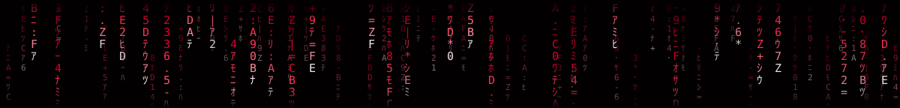

  

  

  <a href="https://github.com/ShadowStrikeOS/ShadowStrike-OS">
    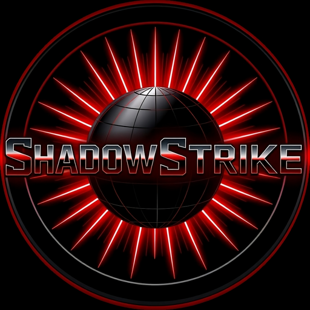
  </a>

### [ShadowStrike OS](https://github.com/ShadowStrikeOS/ShadowStrike-OS): *the platform*

 

- **Purpose:** A Linux distribution of my own design, made for penetration testing and security research, with security at its center.
- **Role:** My principal testbed, where new security tooling is tried and systems are hardened.
- **Status:** Public now, under the [ShadowStrike](https://github.com/ShadowStrikeOS) organization.
- **Architecture:** A hardened base, a tiling window workflow, an expanded toolset in containers, and support for ARM64 virtualization.
- **Key Features:** Role-based tooling menus, integrated WireGuard configurations, and a custom AI assistant built to automate research tasks.
- **Roadmap:** Ahead: post-quantum cryptography integration, and adversarial AI threat modeling.

  

  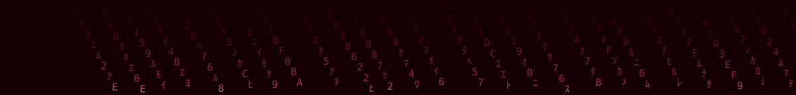

  <a href="https://github.com/NightSalvo">
    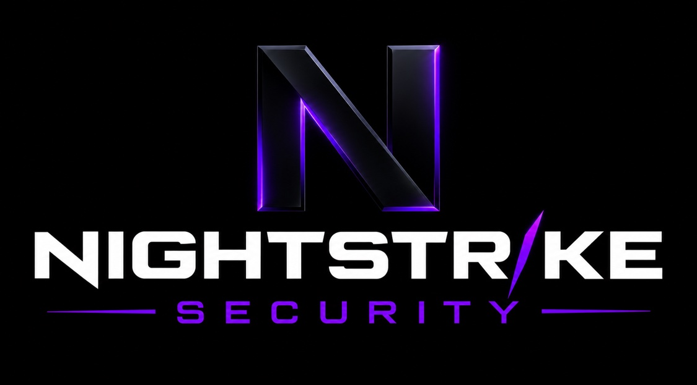
  </a>

<h3 align="center"><a href="https://github.com/NightSalvo">NightSalvo</a>: <em>the flagship tool</em></h3>

<em>Night falls. Threats end.</em>

- The flagship engineering effort, developed in private, with patience, and held to an audit-first standard.
- At its heart, an original architecture in three movements: an autonomous planner, an enforced scope guard, and a hash-chained evidence ledger. Imagination, restraint, proof.
- It was designed so that every action is authorized before it is taken, bounded while it runs, and provable after the fact.
- What can be shown is shown: public artifacts and proof appear through the [NightSalvo](https://github.com/NightSalvo) organization as they clear review.

  

  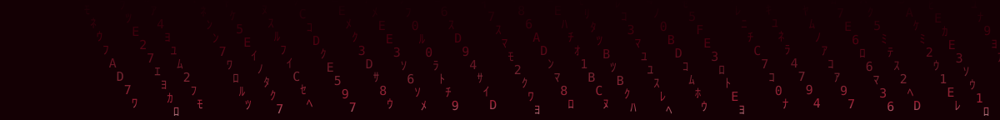

  <a href="https://github.com/ShatterpointSecurity">
    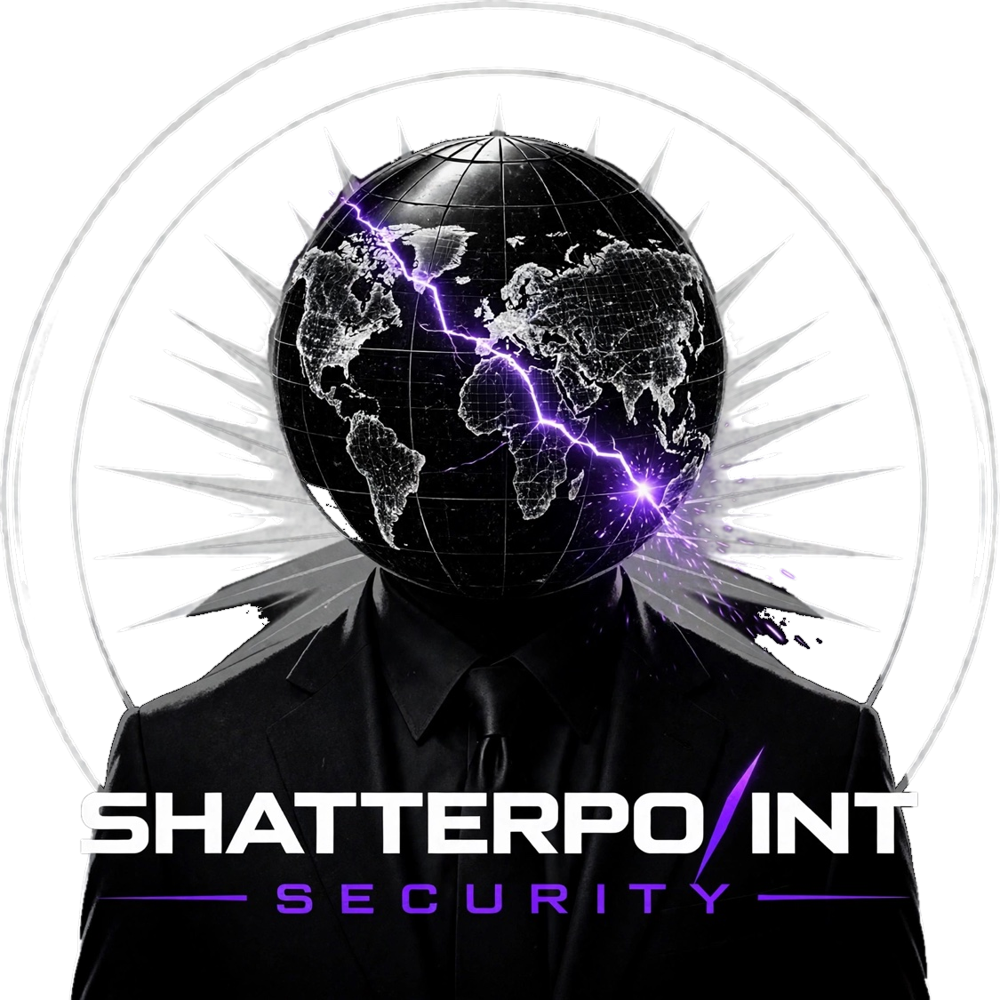
  </a>

### [Shatterpoint Security](https://github.com/ShatterpointSecurity): *the firm*

- **Role:** Founder of **[Shatterpoint Security](https://github.com/ShatterpointSecurity)**.
- **Practice:** An offensive-security practice in formation, deliberately boutique: small by design, exacting by habit.
- **Services:** Penetration testing · red teaming · AI security testing.

  

  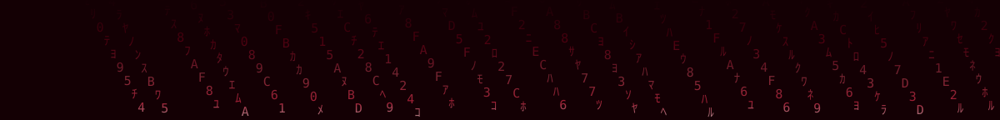

  

- I am Gavin Blacklock. Since I was twelve, I have been asking how systems work. I never stopped asking.
- The last five years belong to three crafts: systems engineering, offensive tradecraft, and autonomous tools.
- I build at the intersection of AI and systems security, and security comes first.
- I work both sides of the discipline. **I build, and I break.**
- The duality even has a color: purple. To defend well, first understand the offense. That is the method behind everything below.

  

  

  

- **NSA Codebreaker Challenge (2023–2024)**
  - Seventy-second in the nation, **competing solo** against multi-person university teams: the top 16% of more than 450 institutions.
  - Level 7 reached within the first 10 days of a four-month competition.
  - Held the **#1 rank on the institutional leaderboard**.
  - And a first: through direct outreach to the NSA, my high school became the first high school ever to participate in the program.
- **CyberStart America (2022–2024)**
  - **National Cyber Scholar with Honors, three consecutive years.** The title goes to 600 of 30,000 students who seek to qualify: the top 2% of the national cybersecurity student funnel.
  - In the top 1% of tens of thousands of participants.
  - The **maximum possible points, 147,600**, in every program year.
  - **$12,000 in scholarships** earned.
- **GIAC Advisory Board**: An invitation to the guidance community reserved for top scorers on SANS/GIAC certification exams.
- **FBI TEAM Program**: Chosen for the FBI's competitive Teen/Youth Engagement and Mentorship program, and mentored by Bureau personnel.

  

  

  

  

<em>Every badge on this page can be checked.</em>

- **GIAC Security Essentials (GSEC)** · **GIAC Foundational Cybersecurity Technologies (GFACT)**
- **AP Scholar with Honors**
- One of the only dual-award recipients (Business & Computer Science) in a graduating class of ~1,000
- Verified Member of the GitHub Developer Program

  

  

  

  

  

### [Event_Zero](https://github.com/Epsilon0xCell/Event_Zero)

- **Design:** An experimental AI analysis environment, composed around strict isolation.
- **Separation:** The host system remains completely separate from the analysis environment.
- **Containment:** The AI operates inside a container that does not persist.
- **Access:** Kernel access is restricted. There is no path to the underlying OS.

  

  

  <a href="https://github.com/Epsilon0xCell/Eclipse-Shield">
    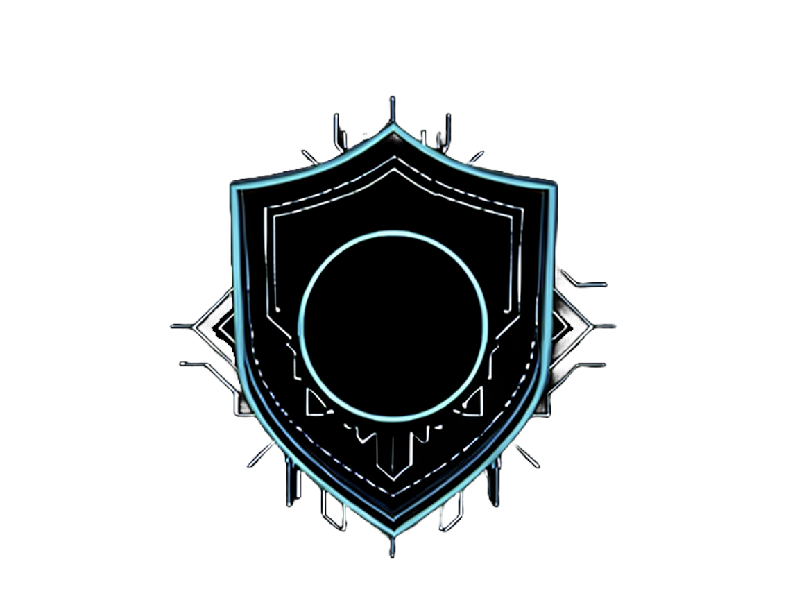
  </a>

### [Eclipse Shield](https://github.com/Epsilon0xCell/Eclipse-Shield): productivity analyzer with a hardened Flask backend

  -red?style=flat-square)

- **Product:** A browser extension and Flask backend that quietly judge whether a site fits the mode of the moment: work, school, or personal.
- **Decision rules:** Local allow and block rules decide first. Where no rule speaks, Gemini may be called.
- **Validation:** A security test suite that passes 30 of 30 against the live server, beside a 33-test pytest suite.

- **AI Task Analysis:** A Gemini integration that asks after context: goals, and current focus.
- **Security coverage:** The full OWASP Top 10 (2021).
- **Security stack:** UFW → Fail2ban → Nginx → Gunicorn → Flask security middleware.
- **Rate limiting:** Redis-backed rate limiting.
- **Input validation:** Careful validation against XSS, SQLi, and prompt injection.
- **Extension traffic:** Guarded by CSRF tokens and request signing.
- **Testing:** 50+ automated security tests, kept on the record.
- **Test coverage:** Authentication bypass, injection, rate limiting, and XSS.

  

  

  <a href="https://github.com/ShadowGuard-AI">
    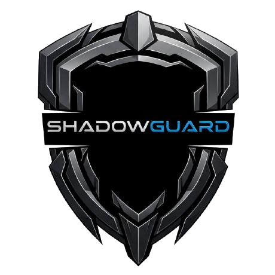
  </a>

### [ShadowGuard AI](https://github.com/ShadowGuard-AI): *the library*

- **Scale:** 584 projects: security tools and experiments, gathered into one library.
- **Direction:** Built with AI assistance, under my direction, and audited line by line.
- **Origin:** First published under the ShadowGuardAI organization.
- **Current home:** Being restored under the [ShadowGuard-AI](https://github.com/ShadowGuard-AI) organization, repository by repository, each in its place.
- **Catalogue:** The full catalogue may be read on the org's [repositories page](https://github.com/orgs/ShadowGuard-AI/repositories).

  

  

#### More from the workshop

- [Spotify-To-YTMusic](https://github.com/Epsilon0xCell/Spotify-To-YTMusic)
- [Custom-Linux-AV](https://github.com/Epsilon0xCell/Custom-Linux-AV)
- [Hacking-Distributions-Trust-Analysis](https://github.com/Epsilon0xCell/Hacking-Distributions-Trust-Analysis)
- The full body of work began on the [archive profile](https://github.com/CY83R-3X71NC710N); it is arriving here repo by repo.

  

  

  

<em>Earned as <a href="https://github.com/CY83R-3X71NC710N">@CY83R-3X71NC710N</a>; every claim below is linked to its source.</em>

- **Star History: [Top Committer #8 of 2024](https://www.star-history.com/cy83r-3x71nc710n)** ([Wayback Machine archive](https://web.archive.org/web/20261030133321/https://www.star-history.com/cy83r-3x71nc710n/))
- **Star History: [Top 1000 Committers 2026: #150, with 13,288 commits](https://www.star-history.com/cy83r-3x71nc710n)** ([Wayback Machine archive](https://web.archive.org/web/20261030133321/https://www.star-history.com/cy83r-3x71nc710n/))
- **CodersRank: Top 1% of coders in the USA** (below) ([Wayback Machine archive](https://web.archive.org/web/20261030133417/https://profile.codersrank.io/user/CY83R-3X71NC710N))

  <strong>Top 1% Coders USA: CodersRank</strong> 
  <a href="https://profile.codersrank.io/user/CY83R-3X71NC710N">
    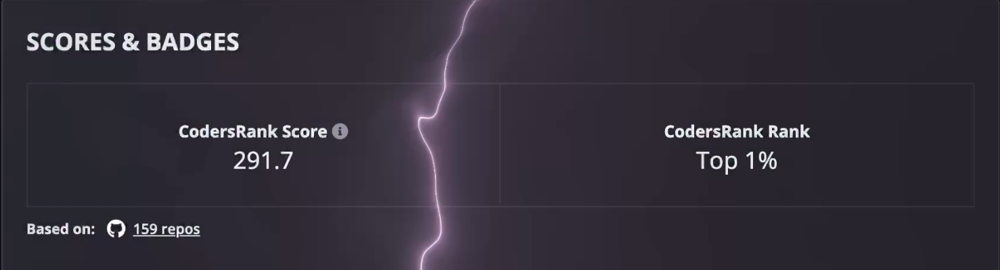
  </a> 
  <em>CodersRank Score 291.7 · Rank: Top 1% · Based on 159 repositories</em>

  

  

  

  

<em>S Rank Hacker · God Committer · God PR User · Ultra Celebrity · Super Repo Creator · Super Star, earned as <a href="https://github.com/CY83R-3X71NC710N">@CY83R-3X71NC710N</a>; the wall links to that profile.</em>

  

  

  

- **[Spotify-To-YTMusic](https://github.com/linsomniac/spotify_to_ytmusic/pull/117)**
  - Brought back an unmaintained project.
  - Patched the core authentication error.
  - Added connection-stability features.
  - Brought in four major community bug fixes.
  - During the original author's absence, my fork became the community's de facto version.
- **[swayfx](https://github.com/WillPower3309/swayfx/pull/406)**
  - Mended a critical build failure in the Wayland compositor fork.
  - Updated its Nix flake dependencies.
  - Improved the development shell for every contributor.
- **[SillyTavern Extension](https://github.com/SillyTavern/Extension-Speech-Recognition/pull/19)**
  - Built a "heartbeat" mechanism.
  - Fixed a persistent Web Speech API bug.
  - The bug lived in a popular AI toolkit (16k+ stars).

  

  

  

- **Cybersecurity:** Offensive security, with red teaming, penetration testing, API security, OSINT, reverse engineering in Ghidra, system hardening, and digital forensics
- **Development:** Python, advanced; C, Nix, and Bash; web development; AI/ML tooling for LLM integration and API automation; Git and CI/CD
- **Systems & Infrastructure:** The internals of Linux, Windows, and macOS; custom OS development; cloud security; virtualization across VMware, Parallels, QEMU, and UTM; Docker; and networking, with VPNs and OpSec

  

  

  

  
  

  

  

  

**Off the keyboard:**

- I write, and THE COMMAND CHAIR is my book.
- I specialize in DJing and AI Human Sounding Soul Music Production, with the human soul at the center.
- I command classic sci-fi real-time strategy games.
- I keep up martial arts, fitness, and long bike rides.
- My listening and mixing range across dark techno, techno, UK drill, rap, R&B, grunge, pop, melancholic romantic dark academia, and melancholic ambient.
- My signature blend sets electronic music and UK drill in the same moment.

*Commits from this account are authored under my GitHub noreply identity: no personal email, ever.*

  

