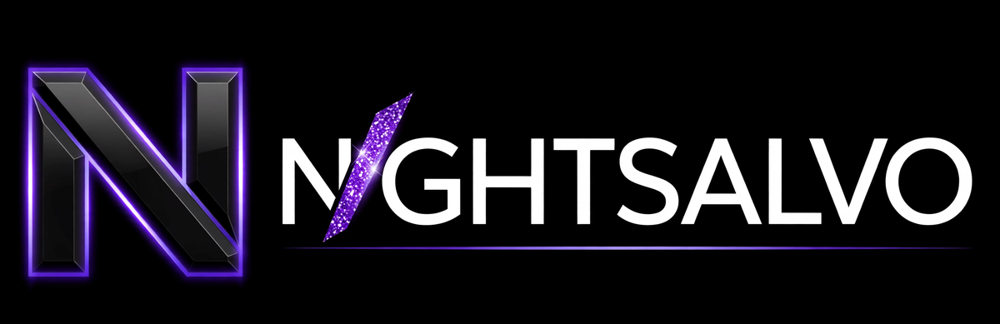
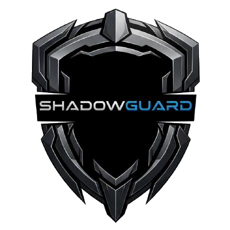

  

  <strong>Cybersecurity Researcher & Developer</strong> 
  <em>Offensive Security · OS Internals · AI-Driven Tooling</em> 
  <em>Penetration Testing · Bug Bounty · Zero-Day Research</em>

  <strong>At a Glance</strong>

- **Role:** Security engineer & researcher working across offensive security, OS internals, and AI-driven tooling.
- **Fleet:** 757 repositories across Epsilon0xCell and my organizations, including the 584-project ShadowGuard-AI library.
- **Succession proof:** [proof-of-succession](https://github.com/Epsilon0xCell/proof-of-succession) indexes 2,867 name-authored commits across 32 repositories.
- **Credentials:** GIAC Security Essentials (GSEC) and GIAC Foundational Cybersecurity Technologies (GFACT); invited to join the GIAC Advisory Board.
- **Recognition:** NSA Codebreaker Challenge #72, competing solo; National Cyber Scholar with Honors for three consecutive years.
- **Flagships:** ShadowStrike OS for platform work, NightSalvo for the flagship tool, Event_Zero for isolated AI analysis, and Eclipse Shield for a hardened Flask backend.

> **Successor account.** This is the new home of the builder behind [@CY83R-3X71NC710N](https://github.com/CY83R-3X71NC710N), an account I opened in April 2022 at fifteen years old and built over four years into 163 repositories and a nationally ranked open-source record. I stopped working from it in September 2026 and consolidated everything here, with full histories migrated and re-signed under this account's identity. The original stands untouched as the archive of record, and everything new ships from here.

> **One builder, two accounts.** The old account is retired and cannot post, so it cannot vouch for this one, and copied code alone would prove nothing anyway: everything it published is public, and anyone can copy public work. Two things cannot be copied into existence. The lineage: the project histories continue here without a break, including Event_Zero, Eclipse-Shield, and the ShadowGuard library now restoring under the [ShadowGuard-AI](https://github.com/ShadowGuard-AI) organization, the same commits carried forward and re-signed under this account. And the name: the old account's history carries my full legal name, the name listed on my LinkedIn, as the author of [2,867 of its commits](https://github.com/CY83R-3X71NC710N) across 32 repositories, written between January and May 2023, before my git identity switched to my handle, and years before this account existed. Every one of those commits is indexed in [proof-of-succession](https://github.com/Epsilon0xCell/proof-of-succession), together with the Terms of Service basis for the succession. The rest of the record matches as well, offered as consistency rather than proof: the starred library matches the old account exactly, 168 of 168 repositories, and its following network is being rebuilt name by name, ending with the old account itself. If the old account still shows fresh commits, that is its CI/CD: GitHub Actions workflows I built years ago, including a weather dashboard updater and a quote scraper, still run on schedule and commit on their own, with no human working from that account since September 2026.

  

  

  

  

  

### [ShadowStrike OS](https://github.com/ShadowStrikeOS/ShadowStrike-OS): *the platform*

- **Purpose:** A custom, security-focused Linux distribution engineered for penetration testing and security research.
- **Role:** My primary development testbed for novel security tooling and system hardening.
- **Status:** Now public under the [ShadowStrike](https://github.com/ShadowStrikeOS) organization.
- **Architecture:** Hardened base with a tiling window workflow, an expanded containerized toolset, and ARM64 virtualization support.
- **Key Features:** Role-based tooling menus, integrated WireGuard configurations, and a custom AI assistant for automating research tasks.
- **Roadmap:** Post-quantum cryptography integration and adversarial AI threat modeling.

  

  

  

<h3 align="center"><a href="https://github.com/NightSalvo">NightSalvo</a>: <em>the flagship tool</em></h3>

<em>Night falls. Threats end.</em>

- The flagship engineering effort, developed in private and held to an audit-first standard.
- Its original core architecture is an autonomous planner, an enforced scope guard, and a hash-chained evidence ledger.
- Designed so that every action the system takes is authorized, bounded, and provable after the fact.
- Public artifacts and proof are released through the [NightSalvo](https://github.com/NightSalvo) organization as they clear review.

  

  

  

### [Shatterpoint Security](https://github.com/ShatterpointSecurity): *the firm*

- **Role:** Founder of **[Shatterpoint Security](https://github.com/ShatterpointSecurity)**.
- **Practice:** A boutique offensive-security practice in formation.
- **Services:** Penetration testing · red teaming · AI security testing.

  

  

  

- My fascination with technology began with a fundamental curiosity about how systems work, pursued since age 12.
- For the last five years, focused on systems engineering, offensive security tradecraft, and autonomous tool development.
- I build robust, security-first solutions at the intersection of AI and systems security.
- I work both sides of the discipline: **I build and I break.**
- That purple-shaded duality, mastering defense by understanding offense, is the methodology behind everything below.

  

  

  

- **NSA Codebreaker Challenge (2023–2024)**
  - Placed **#72 nationally, competing solo** against multi-person university teams (top 16% of 450+ institutions).
  - Reached Level 7 within the first 10 days of the four-month competition.
  - Held the **#1 rank on the institutional leaderboard**.
  - Through direct outreach to the NSA, made my high school the first high school ever to participate in the program.
- **CyberStart America (2022–2024)**
  - **National Cyber Scholar with Honors, three consecutive years.**
  - Top 1% of tens of thousands of participants.
  - Achieved the **maximum possible points** in every program year.
  - **$12,000 in scholarships** earned.
- **GIAC Advisory Board**: Invited to join the guidance community reserved for top scorers on SANS/GIAC certification exams.
- **FBI TEAM Program**: Selected for the FBI's competitive Teen/Youth Engagement and Mentorship program, receiving mentorship from Bureau personnel.

  

  

  

  

<em>Every badge on this page can be checked.</em>

- **GIAC Security Essentials (GSEC)** · **GIAC Foundational Cybersecurity Technologies (GFACT)**
- **AP Scholar with Honors**
- One of the only dual-award recipients (Business & Computer Science) in a graduating class of ~1,000
- Verified Member of the GitHub Developer Program

  

  

  

  

  

### [Event_Zero](https://github.com/Epsilon0xCell/Event_Zero)

- **Design:** An experimental AI analysis environment built around strict isolation.
- **Separation:** The host system is completely separated from the analysis environment.
- **Containment:** The AI operates inside a non-persistent container.
- **Access:** Restricted kernel access and no path to the underlying OS.

  

  

  

### [Eclipse Shield](https://github.com/Epsilon0xCell/Eclipse-Shield): productivity analyzer with a hardened Flask backend

- **Product:** A browser extension and Flask backend that judge whether a site fits your current mode: work, school, or personal.
- **Decision rules:** Decisions run on local allow and block rules, with optional Gemini calls for sites no rule covers.
- **Validation:** Ships with a security test suite that passes 30 of 30 against the live server, plus a 33-test pytest suite.

- **AI Task Analysis:** Gemini integration that asks contextual questions to understand goals and current focus
- **Security coverage:** Full OWASP Top 10 (2021) coverage.
- **Security stack:** UFW → Fail2ban → Nginx → Gunicorn → Flask security middleware.
- **Rate limiting:** Redis-backed rate limiting.
- **Input validation:** Comprehensive input validation against XSS, SQLi, and prompt injection.
- **Extension traffic:** CSRF tokens and request signing.
- **Testing:** 50+ automated security tests.
- **Test coverage:** Authentication bypass, injection, rate limiting, and XSS.

  

  

  

### [ShadowGuard AI](https://github.com/ShadowGuard-AI): *the library*

- **Scale:** A 584-project library of security tools and experiments.
- **Direction:** Built with AI assistance under my direction.
- **Origin:** Originally published under the ShadowGuardAI organization.
- **Current home:** Now being restored under the [ShadowGuard-AI](https://github.com/ShadowGuard-AI) organization, repository by repository.
- **Catalogue:** The full catalogue lives on the org's [repositories page](https://github.com/orgs/ShadowGuard-AI/repositories).

  

  

#### More from the workshop

- [Spotify-To-YTMusic](https://github.com/Epsilon0xCell/Spotify-To-YTMusic)
- [Custom-Linux-AV](https://github.com/Epsilon0xCell/Custom-Linux-AV)
- [Hacking-Distributions-Trust-Analysis](https://github.com/Epsilon0xCell/Hacking-Distributions-Trust-Analysis)
- The full body of work on the [archive profile](https://github.com/CY83R-3X71NC710N), now migrating here repo by repo.

  

  

  

<em>Earned as <a href="https://github.com/CY83R-3X71NC710N">@CY83R-3X71NC710N</a>, every claim below links to its source.</em>

- **Star History: [Top Committer #8 of 2024](https://www.star-history.com/cy83r-3x71nc710n)** ([Wayback Machine archive](https://web.archive.org/web/20261030133321/https://www.star-history.com/cy83r-3x71nc710n/))
- **Star History: [Top 1000 Committers 2026: #150, with 13,288 commits](https://www.star-history.com/cy83r-3x71nc710n)** ([Wayback Machine archive](https://web.archive.org/web/20261030133321/https://www.star-history.com/cy83r-3x71nc710n/))
- **CodersRank: Top 1% of coders in the USA** (below) ([Wayback Machine archive](https://web.archive.org/web/20261030133417/https://profile.codersrank.io/user/CY83R-3X71NC710N))

  <strong>Top 1% Coders USA: CodersRank</strong> 
   
  <em>CodersRank Score 291.7 · Rank: Top 1% · Based on 159 repositories</em>

  

  

  

  

<em>S Rank Hacker · God Committer · God PR User · Ultra Celebrity · Super Repo Creator · Super Star, earned as <a href="https://github.com/CY83R-3X71NC710N">@CY83R-3X71NC710N</a>; the wall links to that profile.</em>

  

  

  

- **[Spotify-To-YTMusic](https://github.com/linsomniac/spotify_to_ytmusic/pull/117)**
  - Revived an unmaintained project.
  - Patched the core authentication error.
  - Added connection-stability features.
  - Integrated four major community bug fixes.
  - My fork became the community's de facto version during the original author's absence.
- **[swayfx](https://github.com/WillPower3309/swayfx/pull/406)**
  - Patched a critical build failure in the Wayland compositor fork.
  - Updated its Nix flake dependencies.
  - Improved the development shell for all contributors.
- **[SillyTavern Extension](https://github.com/SillyTavern/Extension-Speech-Recognition/pull/19)**
  - Built a "heartbeat" mechanism.
  - Fixed a persistent Web Speech API bug.
  - The bug was in a popular AI toolkit (16k+ stars).

  

  

  

- **Cybersecurity:** Offensive Security (Red Teaming), Penetration Testing, API Security, OSINT, Reverse Engineering (Ghidra), System Hardening, Digital Forensics
- **Development:** Python (Advanced), C, Nix, Bash, Web Development, AI/ML Tooling (LLM Integration, API Automation), Git, CI/CD
- **Systems & Infrastructure:** Linux / Windows / macOS Internals, Custom OS Development, Cloud Security, Virtualization (VMware, Parallels, QEMU, UTM), Docker, Networking (VPNs, OpSec)

  

  

  

  
  

  

  

  

**Off the keyboard:**

- I write, and I am the author of THE COMMAND CHAIR.
- I DJ and produce electronic music, with production via AI prompting.
- I play piano and guitar just for fun.
- I command classic sci-fi real-time strategy games.
- I keep up martial arts, fitness, and long bike rides.
- In music I mix and listen across dark techno, techno, UK drill, rap, R&B, grunge, pop, melancholic romantic dark academia, and melancholic ambient.
- My signature blend layers electronic music and UK drill at the same time.

*All commits from this account are authored under my GitHub noreply identity, no personal email, ever.*

  

