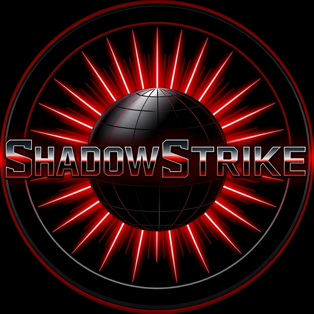
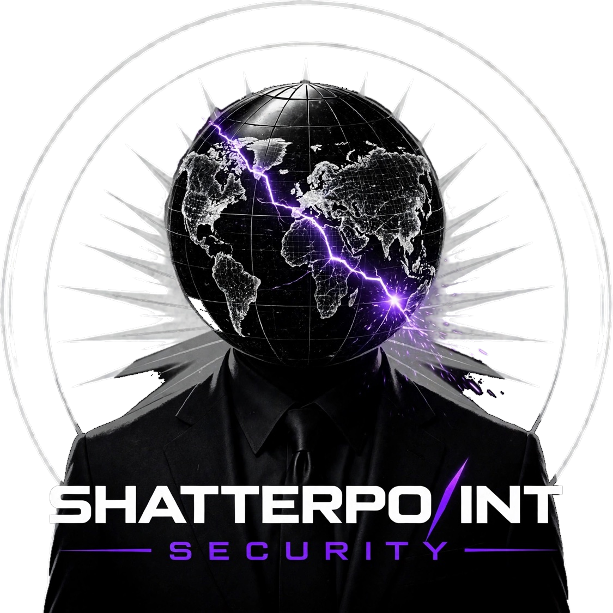
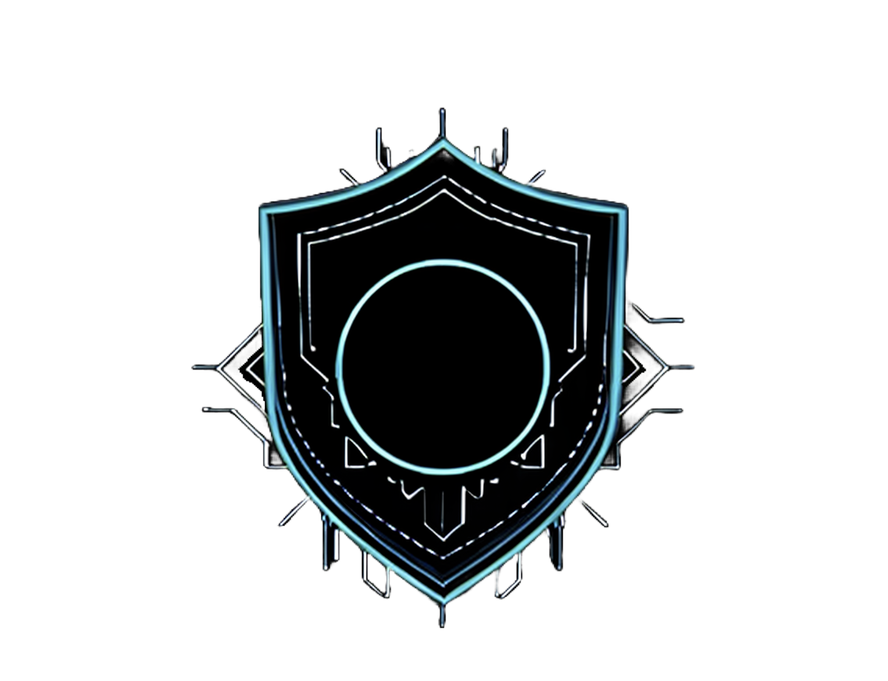
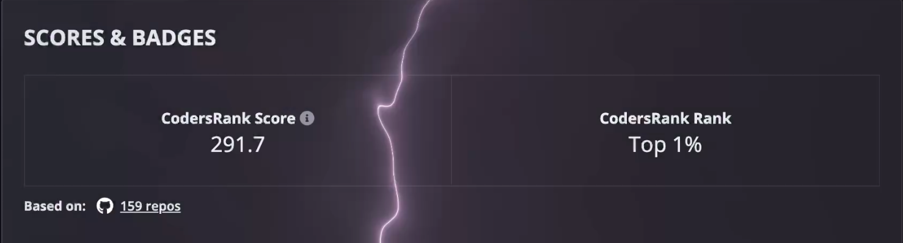

<h1 align="center">Epsilon0xCell</h1>

  <strong>Cybersecurity Researcher & Developer</strong> 
  <em>Offensive Security · OS Internals · AI-Driven Tooling</em> 
  <em>Penetration Testing · Bug Bounty · Zero-Day Research</em>

> **Successor account.** This is the new home of the builder behind [@CY83R-3X71NC710N](https://github.com/CY83R-3X71NC710N). That account is permanently locked out (lost 2FA) and remains as a read-only archive of my 2023–2026 work: 163 repositories and my open-source record. Everything new ships from here, with full histories migrated and re-signed under this account's identity.

---

<h2 align="center">Flagships</h2>

---

  

### [ShadowStrike OS](https://github.com/ShadowStrikeOS/ShadowStrike-OS): *the platform*

A custom, security-focused Linux distribution engineered for penetration testing and security research, my primary development testbed for novel security tooling and system hardening. *(Now public under the [ShadowStrike](https://github.com/ShadowStrikeOS) organization.)*

- **Architecture:** Hardened base with a tiling window workflow, an expanded containerized toolset, and ARM64 virtualization support.
- **Key Features:** Role-based tooling menus, integrated WireGuard configurations, and a custom AI assistant for automating research tasks.
- **Roadmap:** Post-quantum cryptography integration and adversarial AI threat modeling.

---

<h3 align="center"><a href="https://github.com/NightSalvo">NightSalvo</a>: <em>the flagship tool</em></h3>

The flagship engineering effort, developed in private and held to an audit-first standard. Its original core architecture is an autonomous planner, an enforced scope guard, and a hash-chained evidence ledger, designed so that every action the system takes is authorized, bounded, and provable after the fact. Public artifacts and proof are released through the [NightSalvo](https://github.com/NightSalvo) organization as they clear review.

---

  

### [Shatterpoint Security](https://github.com/ShatterpointSecurity): *the firm*

Founder of **[Shatterpoint Security](https://github.com/ShatterpointSecurity)**: a boutique offensive-security practice in formation. Penetration testing · red teaming · AI security testing.

---

<h2 align="center">About</h2>

My fascination with technology began with a fundamental curiosity about how systems work, pursued since age 12, and for the last five years focused on systems engineering, offensive security tradecraft, and autonomous tool development. I build robust, security-first solutions at the intersection of AI and systems security, and I work both sides of the discipline: **I build and I break.** That purple-shaded duality, mastering defense by understanding offense, is the methodology behind everything below.

---

<h2 align="center">Key Achievements & Recognition</h2>

- **NSA Codebreaker Challenge (2023–2024)**: Placed **#72 nationally, competing solo** against multi-person university teams (top 16% of 450+ institutions). Reached Level 7 within the first 10 days of the four-month competition, holding the **#1 rank on the institutional leaderboard**, and pioneered my high school's first-ever participation in the collegiate-level program through direct outreach to the NSA.
- **CyberStart America (2022–2024)**: **National Cyber Scholar with Honors, three consecutive years.** Top 1% of tens of thousands of participants, achieving the **maximum possible points** in every program year; **$12,000 in scholarships** earned.
- **GIAC Advisory Board**: Invited to join the guidance community reserved for top scorers on SANS/GIAC certification exams.
- **FBI TEAM Program**: Selected for the FBI's competitive Teen/Youth Engagement and Mentorship program, receiving mentorship from Bureau personnel.

---

<h2 align="center">Education & Certifications</h2>

- **GIAC Security Essentials (GSEC)** · **GIAC Foundational Cybersecurity Technologies (GFACT)**
- **AP Scholar with Honors**
- One of the only dual-award recipients (Business & Computer Science) in a graduating class of ~1,000
- Verified Member of the GitHub Developer Program

---

<h2 align="center">Featured Projects</h2>

---

  

### [Event_Zero](https://github.com/Epsilon0xCell/Event_Zero)

An experimental AI analysis environment built around strict isolation: the host system is completely separated from the analysis environment, and the AI operates inside a non-persistent container with restricted kernel access and no path to the underlying OS.

---

  

### [Eclipse Shield](https://github.com/Epsilon0xCell/Eclipse-Shield): AI-powered productivity analyzer with enterprise security

An intelligent system that uses AI to analyze browsing patterns and block unproductive sites based on contextual task understanding, with a browser-extension fleet reporting to a hardened backend.

- **AI Task Analysis:** Gemini integration that asks contextual questions to understand goals and current focus
- **Enterprise Security Implementation:** Full OWASP Top 10 (2021) coverage: UFW → Fail2ban → Nginx → Gunicorn → Flask security middleware; Redis-backed rate limiting; comprehensive input validation against XSS, SQLi, and prompt injection; CSRF tokens and request signing for extension traffic
- **Testing:** 50+ automated security tests covering authentication bypass, injection, rate limiting, and XSS

---

#### More from the workshop

[Best-RSS-Tool](https://github.com/Epsilon0xCell/Best-RSS-Tool) · [Epic-Calculator](https://github.com/Epsilon0xCell/Epic-Calculator) · [macos-terminal-video-high-quality](https://github.com/Epsilon0xCell/macos-terminal-video-high-quality), and the full body of work on the [archive profile](https://github.com/CY83R-3X71NC710N), now migrating here repo by repo.

---

<h2 align="center">Rankings</h2>

<em>Earned as <a href="https://github.com/CY83R-3X71NC710N">@CY83R-3X71NC710N</a>, every claim below links to its source.</em>

- **Star History: [Top Committer #8 of 2024](https://www.star-history.com/cy83r-3x71nc710n)**
- **Star History: [Top 1000 Committers 2026: #150, with 13,288 commits](https://www.star-history.com/cy83r-3x71nc710n)**
- **CodersRank: Top 1% of coders in the USA** (below)

  <strong>Top 1% Coders USA: CodersRank</strong> 
   
  <em>CodersRank Score 291.7 · Rank: Top 1% · Based on 159 repositories</em>

---

<h2 align="center">Trophy Wall</h2>

  

<em>S Rank Hacker · God Committer · God PR User · Ultra Celebrity · Super Repo Creator · Super Star, earned as <a href="https://github.com/CY83R-3X71NC710N">@CY83R-3X71NC710N</a>; the wall links to that profile.</em>

---

<h2 align="center">Open Source Contributions</h2>

- **[spotify_to_ytmusic](https://github.com/linsomniac/spotify_to_ytmusic/pull/117)**: Revived an unmaintained project: patched the core authentication error, added connection-stability features, and integrated four major community bug fixes. My fork became the community's de facto version during the original author's absence.
- **[swayfx](https://github.com/WillPower3309/swayfx/pull/406)**: Patched a critical build failure in the Wayland compositor fork by updating its Nix flake dependencies, improving the development shell for all contributors.
- **[SillyTavern Extension](https://github.com/SillyTavern/Extension-Speech-Recognition/pull/19)**: Built a "heartbeat" mechanism fixing a persistent Web Speech API bug in a popular AI toolkit (16k+ stars).

---

<h2 align="center">Key Expertise</h2>

- **Cybersecurity:** Offensive Security (Red Teaming), Penetration Testing, API Security, OSINT, Reverse Engineering (Ghidra), System Hardening, Digital Forensics
- **Development:** Python (Advanced), C, Nix, Bash, Web Development, AI/ML Tooling (LLM Integration, API Automation), Git, CI/CD
- **Systems & Infrastructure:** Linux / Windows / macOS Internals, Custom OS Development, Cloud Security, Virtualization (VMware, Parallels, QEMU, UTM), Docker, Networking (VPNs, OpSec)

---

  
  

---

**Off the keyboard:** DJing and music production (performing as GRAVIT8), guitar, martial arts, fitness, and long bike rides.

*All commits from this account are authored under my GitHub noreply identity, no personal email, ever.*
