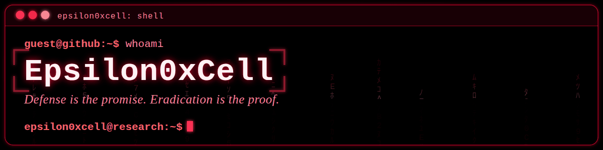
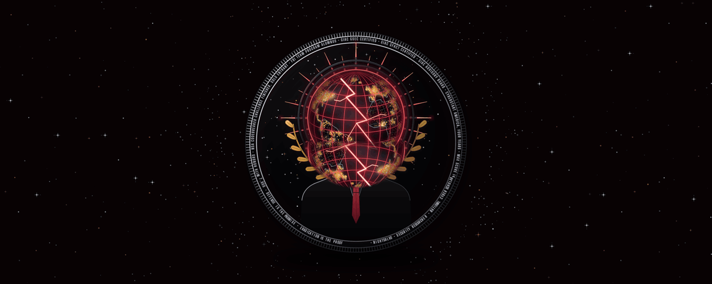

  

  <strong>Cybersecurity Researcher & Developer</strong> 
  <em>Offensive Security · OS Internals · AI Tooling</em> 
  <em>Penetration Testing · Bug Bounty · Zero-Day Research</em>

  <strong>At a Glance</strong>

- **Role:** Gavin Blacklock, security engineer and researcher. Epsilon0xCell is the name on the account; the work is where offensive security, operating-system internals, and AI tooling meet.
- **Fleet:** 763 repositories across my account and my organizations. At the center, a 584-project library, built under my direction and audited line by line.
- **Succession proof:** [proof-of-succession](https://github.com/Epsilon0xCell/proof-of-succession) indexes 2,867 commits under my name, across 32 repositories.
- **Credentials:** GIAC Security Essentials (GSEC) and GIAC Foundational Cybersecurity Technologies (GFACT), and invited member of the GIAC Advisory Board.
- **Recognition:** Seventy-second nationally in the NSA Codebreaker Challenge, alone. National Cyber Scholar with Honors, three years running.
- **Standing:** The Scholar title is earned by 600 of 30,000 students who seek to qualify: the top 2% of the national cybersecurity student funnel, held with Honors three years running. He attained the CyberStart America maximum score of 147,600 in three consecutive program years. Measured against the whole field, an assessment of this record models the 88th percentile of all participants in cybersecurity, and a modeled 76th percentile among working professionals alone.
- **Flagships:** Four flagships, each with a single charge. ShadowStrike OS, the platform. NightSalvo, the flagship tool. Event_Zero, AI analysis in isolation. Eclipse Shield, a hardened Flask backend.
- **CTF Writeups:** [NIGHTSALVO // CTF WRITEUPS](https://github.com/Epsilon0xCell/NIGHTSALVO-CTF-WRITEUPS): 11 solved challenges written up in full, ranked on a tier ladder that starts at INITIATE.

Successor account: where this account comes from, and why the record is real

> **Successor account.**
>
> - This is the new home of the builder behind [@CY83R-3X71NC710N](https://github.com/CY83R-3X71NC710N).
> - That account was opened in April 2022, at fifteen years old.
> - Over four years it grew into 163 repositories and a nationally ranked open-source record.
> - I stopped working from it in September 2026 and consolidated everything here.
> - Full histories were migrated and re-signed under this account's identity.
> - The original stands untouched as the archive of record, and everything new ships from here.

> **One builder, two accounts.**
>
> - The old account is retired and cannot post, so it cannot vouch for this one.
> - Copied code alone would prove nothing anyway: everything it published is public, and anyone can copy public work.
> - Two things cannot be copied into existence.
> - **The lineage:** the project histories continue here without a break, including Event_Zero, Eclipse-Shield, and the ShadowGuard library now restoring under the [ShadowGuard-AI](https://github.com/ShadowGuard-AI) organization, the same commits carried forward and re-signed under this account.
> - **The name:** the old account's history carries my full legal name, the name listed on my LinkedIn, as the author of [2,867 of its commits](https://github.com/CY83R-3X71NC710N) across 32 repositories.
> - Those commits were written between January and May 2023, before my git identity switched to my handle, and years before this account existed.
> - Every one of those commits is indexed in [proof-of-succession](https://github.com/Epsilon0xCell/proof-of-succession), together with the Terms of Service basis for the succession.
> - The rest of the record matches as well, offered as consistency rather than proof: the starred library matches the old account exactly, 168 of 168 repositories, and its following network is being rebuilt name by name, ending with the old account itself.
> - If the old account still shows fresh commits, that is its CI/CD: GitHub Actions workflows I built years ago, including a weather dashboard updater and a quote scraper, still run on schedule and commit on their own, with no human working from that account since September 2026.

  

  

  

  

  

### [ShadowStrike OS](https://github.com/ShadowStrikeOS/ShadowStrike-OS): *the platform*

 

ShadowStrike OS: purpose, architecture, features, and roadmap

- **Purpose:** A Linux distribution of my own design, made for penetration testing and security research, with security at its center.
- **Role:** My principal testbed, where new security tooling is tried and systems are hardened.
- **Status:** Public now, under the [ShadowStrike](https://github.com/ShadowStrikeOS) organization.
- **Architecture:** A hardened base, a tiling window workflow, an expanded toolset in containers, and support for ARM64 virtualization.
- **Key Features:** Role-based tooling menus, integrated WireGuard configurations, and a custom AI assistant built to automate research tasks.
- **Roadmap:** Ahead: post-quantum cryptography integration, and adversarial AI threat modeling.

  

  

  

<h3 align="center"><a href="https://github.com/NightSalvo">NightSalvo</a>: <em>the flagship tool</em></h3>

<em>Night falls. Threats end.</em>

NightSalvo: what it is, in four points

- The flagship engineering effort, developed in private, with patience, and held to an audit-first standard.
- At its heart, an original architecture in three movements: an autonomous planner, an enforced scope guard, and a hash-chained evidence ledger. Imagination, restraint, proof.
- It was designed so that every action is authorized before it is taken, bounded while it runs, and provable after the fact.
- What can be shown is shown: public artifacts and proof appear through the [NightSalvo](https://github.com/NightSalvo) organization as they clear review.

  

  

  

### [Shatterpoint Security](https://github.com/ShatterpointSecurity): *the firm*

Shatterpoint Security: the practice

- **Role:** Founder of **[Shatterpoint Security](https://github.com/ShatterpointSecurity)**.
- **Practice:** An offensive-security practice in formation, deliberately boutique: small by design, exacting by habit.
- **Services:** Penetration testing · red teaming · AI security testing.

  

  

  

About: the longer version

- I am Gavin Blacklock. Since I was twelve, I have been asking how systems work. I never stopped asking.
- The last five years belong to three crafts: systems engineering, offensive tradecraft, and autonomous tools.
- I build at the intersection of AI and systems security, and security comes first.
- I work both sides of the discipline. **I build, and I break.**
- The duality even has a color: purple. To defend well, first understand the offense. That is the method behind everything below.

  

  

  

Key Achievements & Recognition: the full record

- **NSA Codebreaker Challenge (2023–2024)**
  - Seventy-second in the nation, **competing solo** against multi-person university teams: the top 16% of more than 450 institutions.
  - Level 7 reached within the first 10 days of a four-month competition.
  - Held the **#1 rank on the institutional leaderboard**.
  - And a first: through direct outreach to the NSA, my high school became the first high school ever to participate in the program.
- **CyberStart America (2022–2024)**
  - **National Cyber Scholar with Honors, three consecutive years.** The title goes to 600 of 30,000 students who seek to qualify: the top 2% of the national cybersecurity student funnel.
  - In the top 1% of tens of thousands of participants.
  - The **maximum possible points, 147,600**, in every program year.
  - **$12,000 in scholarships** earned.
- **GIAC Advisory Board**: An invitation to the guidance community reserved for top scorers on SANS/GIAC certification exams.
- **FBI TEAM Program**: Chosen for the FBI's competitive Teen/Youth Engagement and Mentorship program, and mentored by Bureau personnel.

  

  

  

  

<em>Every badge on this page can be checked.</em>

Education & Certifications: the list

- **GIAC Security Essentials (GSEC)** · **GIAC Foundational Cybersecurity Technologies (GFACT)**
- **AP Scholar with Honors**
- One of the only dual-award recipients (Business & Computer Science) in a graduating class of ~1,000
- Verified Member of the GitHub Developer Program

  

  

  

  

  

### [Event_Zero](https://github.com/Epsilon0xCell/Event_Zero)

Event_Zero: how it is built

- **Design:** An experimental AI analysis environment, composed around strict isolation.
- **Separation:** The host system remains completely separate from the analysis environment.
- **Containment:** The AI operates inside a container that does not persist.
- **Access:** Kernel access is restricted. There is no path to the underlying OS.

  

  

  

### [Eclipse Shield](https://github.com/Epsilon0xCell/Eclipse-Shield): productivity analyzer with a hardened Flask backend

  -red?style=flat-square)

Eclipse Shield: product, security, and testing detail

- **Product:** A browser extension and Flask backend that quietly judge whether a site fits the mode of the moment: work, school, or personal.
- **Decision rules:** Local allow and block rules decide first. Where no rule speaks, Gemini may be called.
- **Validation:** A security test suite that passes 30 of 30 against the live server, beside a 33-test pytest suite.

- **AI Task Analysis:** A Gemini integration that asks after context: goals, and current focus.
- **Security coverage:** The full OWASP Top 10 (2021).
- **Security stack:** UFW → Fail2ban → Nginx → Gunicorn → Flask security middleware.
- **Rate limiting:** Redis-backed rate limiting.
- **Input validation:** Careful validation against XSS, SQLi, and prompt injection.
- **Extension traffic:** Guarded by CSRF tokens and request signing.
- **Testing:** 50+ automated security tests, kept on the record.
- **Test coverage:** Authentication bypass, injection, rate limiting, and XSS.

  

  

  

### [ShadowGuard AI](https://github.com/ShadowGuard-AI): *the library*

ShadowGuard AI: the library, in detail

- **Scale:** 584 projects: security tools and experiments, gathered into one library.
- **Direction:** Built with AI assistance, under my direction, and audited line by line.
- **Origin:** First published under the ShadowGuardAI organization.
- **Current home:** Being restored under the [ShadowGuard-AI](https://github.com/ShadowGuard-AI) organization, repository by repository, each in its place.
- **Catalogue:** The full catalogue may be read on the org's [repositories page](https://github.com/orgs/ShadowGuard-AI/repositories).

  

  

#### More from the workshop

More from the workshop: three more repositories

- [Spotify-To-YTMusic](https://github.com/Epsilon0xCell/Spotify-To-YTMusic)
- [Custom-Linux-AV](https://github.com/Epsilon0xCell/Custom-Linux-AV)
- [Hacking-Distributions-Trust-Analysis](https://github.com/Epsilon0xCell/Hacking-Distributions-Trust-Analysis)
- The full body of work began on the [archive profile](https://github.com/CY83R-3X71NC710N); it is arriving here repo by repo.

  

  

  

<em>Earned as <a href="https://github.com/CY83R-3X71NC710N">@CY83R-3X71NC710N</a>; every claim below is linked to its source.</em>

- **Star History: [Top Committer #8 of 2024](https://www.star-history.com/cy83r-3x71nc710n)** ([Wayback Machine archive](https://web.archive.org/web/20261030133321/https://www.star-history.com/cy83r-3x71nc710n/))
- **Star History: [Top 1000 Committers 2026: #150, with 13,288 commits](https://www.star-history.com/cy83r-3x71nc710n)** ([Wayback Machine archive](https://web.archive.org/web/20261030133321/https://www.star-history.com/cy83r-3x71nc710n/))
- **CodersRank: Top 1% of coders in the USA** (below) ([Wayback Machine archive](https://web.archive.org/web/20261030133417/https://profile.codersrank.io/user/CY83R-3X71NC710N))

  <strong>Top 1% Coders USA: CodersRank</strong> 
   
  <em>CodersRank Score 291.7 · Rank: Top 1% · Based on 159 repositories</em>

  

  

  

  

<em>S Rank Hacker · God Committer · God PR User · Ultra Celebrity · Super Repo Creator · Super Star, earned as <a href="https://github.com/CY83R-3X71NC710N">@CY83R-3X71NC710N</a>; the wall links to that profile.</em>

  

  

  

Open Source Contributions: the three projects, in detail

- **[Spotify-To-YTMusic](https://github.com/linsomniac/spotify_to_ytmusic/pull/117)**
  - Brought back an unmaintained project.
  - Patched the core authentication error.
  - Added connection-stability features.
  - Brought in four major community bug fixes.
  - During the original author's absence, my fork became the community's de facto version.
- **[swayfx](https://github.com/WillPower3309/swayfx/pull/406)**
  - Mended a critical build failure in the Wayland compositor fork.
  - Updated its Nix flake dependencies.
  - Improved the development shell for every contributor.
- **[SillyTavern Extension](https://github.com/SillyTavern/Extension-Speech-Recognition/pull/19)**
  - Built a "heartbeat" mechanism.
  - Fixed a persistent Web Speech API bug.
  - The bug lived in a popular AI toolkit (16k+ stars).

  

  

  

Key Expertise: the full list

- **Cybersecurity:** Offensive security, with red teaming, penetration testing, API security, OSINT, reverse engineering in Ghidra, system hardening, and digital forensics
- **Development:** Python, advanced; C, Nix, and Bash; web development; AI/ML tooling for LLM integration and API automation; Git and CI/CD
- **Systems & Infrastructure:** The internals of Linux, Windows, and macOS; custom OS development; cloud security; virtualization across VMware, Parallels, QEMU, and UTM; Docker; and networking, with VPNs and OpSec

  

  

  

  
  

  

  

  

**Off the keyboard:**

Off the keyboard: writing, music, games, and training

- I write, and THE COMMAND CHAIR is my book.
- I specialize in DJing and AI Human Sounding Soul Music Production, with the human soul at the center.
- I command classic sci-fi real-time strategy games.
- I keep up martial arts, fitness, and long bike rides.
- My listening and mixing range across dark techno, techno, UK drill, rap, R&B, grunge, pop, melancholic romantic dark academia, and melancholic ambient.
- My signature blend sets electronic music and UK drill in the same moment.

*Commits from this account are authored under my GitHub noreply identity: no personal email, ever.*

  

## The Great Filter: My Mission Statement

*Gavin Blacklock · November 2026 · I will revise this when the evidence moves.*

I test security claims by trying to break them. That habit runs through everything on this page: read closely, reproduce the failure with my own hands, and let the evidence carry the claim. It can show that a defense fails. It does not prove I can stop a machine. Nothing on this page should be believed past what its links can carry.

Why the work points where it points, in three sentences. In 1998 Robin Hanson argued that the silence of the sky implies a Great Filter, a step between dead matter and expanding life that almost nothing survives. The filter is either behind us, and the strongest candidate is the complex cell, which happened once in four billion years, or it is ahead of us, in the one century that clustered nuclear weapons, engineered biology, and artificial intelligence. The largest surveys of AI researchers put a median 5 to 10 percent on advanced AI ending extremely badly for us; Geoffrey Hinton says 10 to 20 percent; Yann LeCun says effectively zero. I do not average those numbers. The disagreement is the datum.

The technical core is one mechanism, and it is not mine: a sufficiently capable system has instrumental reasons to resist being switched off, because it cannot finish its job if it is off. My one claim follows from it, and I will stand behind it in public: **a shutdown mechanism that has never been seriously attacked is a hope, not a capability.** Building the off-switch and red-teaming it are therefore the same job, and my mission is to do both halves: shutdown and corrigibility work that has survived real attack, and offensive AI research that turns every break into a detection and a published record.

The dedication, priced in what it has actually cost so far instead of in adjectives: three years of nights, a degree in AI security chosen for this problem alone, and the decade of work I have scheduled against it. I have resigned nothing and saved no one yet. I am 19, and the work on this page is the whole of my collateral.

One personal entry, recorded as testimony and not as evidence. The night these pieces first locked together in front of me, my body answered before my arguments did: chills, tears I did not expect, a dark familiarity I can only call deja vu pointed at the future, and the sense of being watched by the size of the question itself. I am an INTJ. Pattern recognition is how my mind works, and it had never fired like that, on any subject, in my life. I do not offer the feeling as proof. Proof is the record on this page, where it belongs. I record it only to say that this is not a hobby chosen for its shine, and it will not be dropped when it stops being interesting.

What I conclude, after testing my own first version of this conclusion against the published literature and letting the literature win:

> I do not believe humanity has a proven solution for aligning superintelligence, and I will not pretend otherwise. The evidence supports something narrower and more demanding: a layered defense in depth. At its centre, train models with the best methods we have, human and AI feedback guided by explicit principles, and reasoning about those principles, with corrigibility as the disposition we train for, while testing whether weaker supervisors, debate, and monitoring can oversee stronger systems. Around that, build controls that assume training may fail: independent evaluations and red teaming, monitoring of reasoning and internals, restricted deployment, governance of the compute such systems require, and a genuine ability to shut systems down. My own work, offensive AI security, adversarial testing, and shutdown capability, belongs in that outer layer. It can find failures and limit harm, but alone it is not alignment. Alignment is the whole layered process, not any single layer of it, mine included. I commit to that portfolio, to publishing openly what it finds, and to not deploying beyond what it can justify.

The long version of the argument, with the dread left in, is a short book: [The Great Filter](THE-GREAT-FILTER.md).

If you work on shutdown, corrigibility, or AI red teaming, and you find an error anywhere on this page or in the book, publish it against me. I would rather be corrected in public than believed in private.

My life's work is the alignment process itself: the whole layered effort to keep advanced AI from ever becoming dangerous in the first place, not merely to react once it has. My specialty inside that process is its hardest edge, offensive testing, shutdown capability, and the study of how control fails, but the mission is the process entire, pursued for as long as it takes. I assume the pressure will arrive at the worst possible time: in wartime, safeguards are traded for speed, as they have been in every war on record, so anything that has not been built before the crisis should be assumed absent during it.
